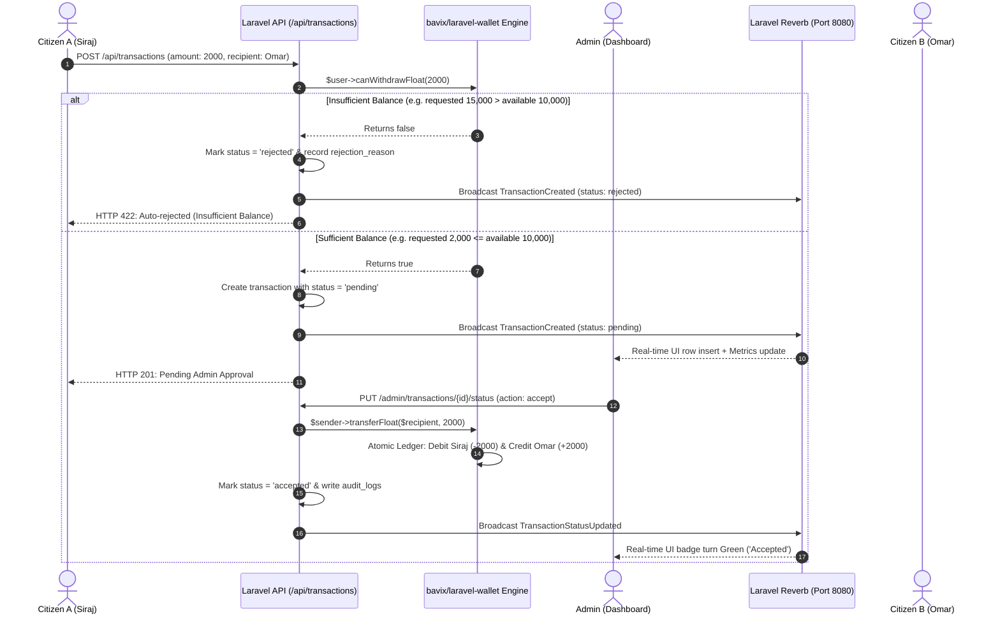
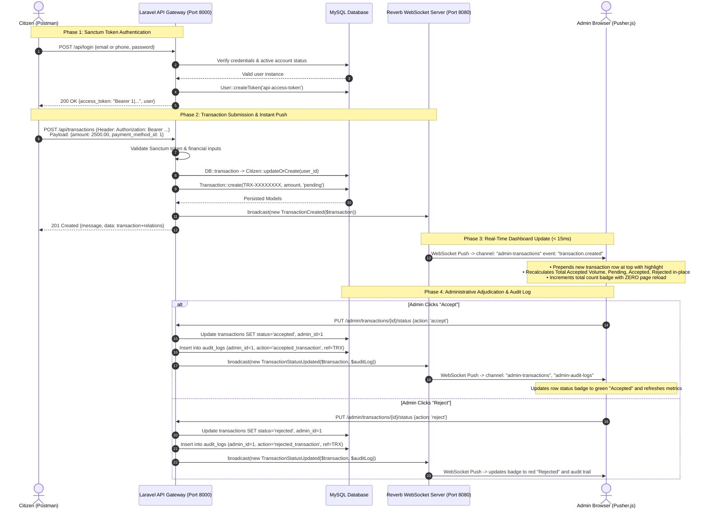

# Financial Transaction System - Comprehensive Architecture, Full ERD & Line-by-Line Code Guide

This document provides complete technical documentation for the Financial Transaction System. It contains the **Full Database Entity Relationship Diagram (ERD)**, detailed relational specifications, and an exhaustive **file-by-file, line-by-line explanation** of every core source file in the application.

---

## Table of Contents
1. [System Architectural Overview](#1-system-architectural-overview)
2. [Complete Database Entity Relationship Diagram (ERD)](#2-complete-database-entity-relationship-diagram-erd)
3. [Database Table Specifications & Data Dictionaries](#3-database-table-specifications--data-dictionaries)
4. [Models: Deep Line-by-Line Explanation](#4-models-deep-line-by-line-explanation)
   - [Citizen.php](#appmodelscitizenphp)
   - [PaymentMethod.php](#appmodelspaymentmethodphp)
   - [Transaction.php](#appmodelstransactionphp)
   - [AuditLog.php](#appmodelsauditlogphp)
   - [User.php](#appmodelsuserphp)
5. [Controllers: Deep Line-by-Line Explanation](#5-controllers-deep-line-by-line-explanation)
   - [Controller.php](#apphttpcontrollerscontrollerphp)
   - [TransactionController.php (API)](#apphttpcontrollersapitransactioncontrollerphp)
   - [DashboardController.php (Admin)](#apphttpcontrollersadmindashboardcontrollerphp)
   - [AuthController.php (Unified Web & API Auth)](#apphttpcontrollersauthcontrollerphp)
6. [Routing Architecture: Deep Line-by-Line Explanation](#6-routing-architecture-deep-line-by-line-explanation)
   - [routes/api.php](#routesapiphp)
   - [routes/web.php](#routeswebphp)
   - [routes/auth.php](#routesauthphp)
7. [Middleware: Deep Line-by-Line Explanation](#7-middleware-deep-line-by-line-explanation)
   - [AdminMiddleware.php](#apphttpmiddlewareadminmiddlewarephp)
   - [CheckUserActive.php](#apphttpmiddlewarecheckuseractivephp)
8. [Blade Views: Layout & Logic Breakdown](#8-blade-views-layout--logic-breakdown)
   - [resources/views/auth/login.blade.php](#resourcesviewsauthloginbladephp)
   - [resources/views/admin/dashboard.blade.php](#resourcesviewsadmindashboardbladephp)
9. [Seeders: Line-by-Line Breakdown](#9-seeders-line-by-line-breakdown)
   - [DatabaseSeeder.php](#databaseseedersdatabaseseederphp)
   - [RolePermissionSeeder.php](#databaseseedersrolepermissionseederphp)
10. [Real-Time Event Architecture with Laravel Reverb WebSockets](#10-real-time-event-architecture-with-laravel-reverb-websockets)
    - [System Sequence & Event Flow](#system-sequence--event-flow)
    - [TransactionCreated Event](#appeventstransactioncreatedphp)
    - [TransactionStatusUpdated Event](#appeventstransactionstatusupdatedphp)
    - [Frontend WebSocket Integration (Blade)](#frontend-websocket-integration)
    - [Configuration & Running Reverb Server](#configuration--running-reverb-server)
11. [End-to-End Workflow & Postman Testing Guide](#11-end-to-end-workflow--postman-testing-guide)
    - [End-to-End Sequence Diagram (Sanctum + Reverb)](#end-to-end-sequence-diagram-sanctum--reverb)
    - [Full Seeded Accounts Directory (Admin & 7 Citizens)](#full-seeded-accounts-directory-admin--7-citizens)
    - [Citizen Workflow: Step-by-Step Postman Testing](#citizen-workflow-step-by-step-postman-testing)
    - [Citizen Negative & Edge Case Testing](#citizen-negative--edge-case-testing)
    - [Admin Workflow & Live Dashboard Verification](#admin-workflow--live-dashboard-verification)
    - [Database & Audit Verification Queries](#database--audit-verification-queries)
    - [Importable Postman Collection JSON](#importable-postman-collection-json)

---

## 1. System Architectural Overview

The system is engineered as a **Separated-Role Financial Processing Gateway**:
1. **Citizen Tier (Headless / API-Only with Laravel Sanctum Token Authentication)**:
   - External clients, mobile apps, or citizens authenticate securely via RESTful HTTP `POST /api/login` using either their **Email** or **Phone Number** (with full support for Libyan phone numbers e.g. `+21891...`, `+21892...`).
   - Upon authentication, Laravel Sanctum issues an API Bearer token (`access_token`).
   - Authenticated citizens initiate financial transactions via `POST /api/transactions` providing strictly financial payload fields (`amount` and `payment_method_id`).
   - The citizen's identity (`name` and `phone_number`) is **automatically and securely resolved from the authenticated token profile**, preventing payload spoofing and guaranteeing database relational integrity.
   - Every transaction submission instantly triggers a WebSocket event via **Laravel Reverb**, pushing live row updates and refreshed KPI metrics to all active administrator screens without polling or page reloads.
2. **Admin Tier (Secured Blade UI & Real-Time WebSocket Dashboard)**:
   - Platform administrators log into a protected web dashboard (`/admin/dashboard`).
   - Guarded by session authentication (`auth`), active status validation (`active_user`), and Role-Based Access Control (`admin` role via Spatie Permissions).
   - Admins inspect incoming transactions, review payment methods and citizen information in real-time, and execute binary workflow decisions: **Accept** or **Reject**.
   - Every administrative status decision permanently logs an immutable audit trail into `audit_logs` and simultaneously broadcasts real-time updates to connected administrative sessions.

---

## 2. Complete Database Entity Relationship Diagram (ERD)

Below is the complete Entity Relationship Diagram illustrating every table, field, primary key, foreign key, uniqueness constraint, and cardinality relationship in the system:

```mermaid
erDiagram
    USERS ||--o{ TRANSACTIONS : "processes as admin (admin_id)"
    USERS ||--o{ AUDIT_LOGS : "performs (admin_id)"
    USERS ||--o{ SESSIONS : "owns (user_id)"
    USERS ||--o{ MODEL_HAS_ROLES : "assigned to"
    ROLES ||--o{ MODEL_HAS_ROLES : "links"
    ROLES ||--o{ ROLE_HAS_PERMISSIONS : "grants"
    PERMISSIONS ||--o{ ROLE_HAS_PERMISSIONS : "defines"

    USERS ||--o| CITIZENS : "links identity (user_id)"
    CITIZENS ||--o{ TRANSACTIONS : "submits as sender (citizen_id)"
    CITIZENS ||--o{ TRANSACTIONS : "receives as recipient (recipient_citizen_id)"
    PAYMENT_METHODS ||--o{ TRANSACTIONS : "used in (payment_method_id)"

    USERS ||--o{ WALLETS : "holds polymorphic wallet (holder_type, holder_id)"
    WALLETS ||--o{ WALLET_TRANSACTIONS : "records double-entry ledger entries (wallet_id)"
    WALLET_TRANSACTIONS ||--o| TRANSFERS : "paired in (deposit_id, withdraw_id)"

    WALLETS {
        bigint id PK "Auto Increment"
        string holder_type "App\\Models\\User"
        bigint holder_id "User primary key"
        string name "Default wallet"
        string slug UK "Unique per holder"
        uuid uuid UK "RFC 4122 UUID"
        text description "Nullable notes"
        json meta "Key-value metadata"
        decimal balance "Balance in smallest unit (scale 2)"
        smallint decimal_places "Default 2"
        timestamp created_at
        timestamp updated_at
    }

    WALLET_TRANSACTIONS {
        bigint id PK "Auto Increment"
        string payable_type "App\\Models\\User"
        bigint payable_id "User primary key"
        bigint wallet_id FK "References wallets(id) ON DELETE CASCADE"
        enum type "deposit, withdraw"
        decimal amount "Ledger transaction amount"
        boolean confirmed "Transaction finalization flag"
        json meta "Metadata including TRX reference"
        uuid uuid UK "Unique transaction identifier"
        timestamp created_at
        timestamp updated_at
    }

    TRANSFERS {
        bigint id PK "Auto Increment"
        string from_type "App\\Models\\User"
        bigint from_id "Sender user ID"
        string to_type "App\\Models\\User"
        bigint to_id "Recipient user ID"
        string status "transfer status"
        string status_last "previous status"
        bigint deposit_id FK "References wallet_transactions(id)"
        bigint withdraw_id FK "References wallet_transactions(id)"
        decimal discount "Transfer discount"
        decimal fee "Transfer fee"
        uuid uuid UK "RFC 4122 UUID"
        timestamp created_at
        timestamp updated_at
    }

    USERS {
        bigint id PK "Auto Increment"
        string name "Max 100"
        string email UK "Max 255"
        timestamp email_verified_at "Nullable"
        string password "Hashed"
        string phone "Nullable, Max 20"
        boolean is_active "Default true"
        string avatar "Nullable, Max 255"
        string remember_token "Nullable"
        timestamp created_at
        timestamp updated_at
    }

    CITIZENS {
        bigint id PK "Auto Increment"
        bigint user_id FK,UK "Unique, references users(id) ON DELETE CASCADE"
        string name "Citizen full name"
        string phone_number UK "Unique phone number"
        timestamp created_at
        timestamp updated_at
    }

    PAYMENT_METHODS {
        bigint id PK "Auto Increment"
        string name UK "Credit Card, Bank Transfer, PayPal"
        boolean is_active "Default true"
        timestamp created_at
        timestamp updated_at
    }

    TRANSACTIONS {
        bigint id PK "Auto Increment"
        string unique_reference_number UK "e.g. TRX-A1B2C3D4"
        decimal amount "Precision 10, Scale 2"
        enum status "pending, accepted, rejected (Default pending)"
        text rejection_reason "Nullable, auto-rejection or admin note"
        bigint citizen_id FK "Sender, References citizens(id) ON DELETE CASCADE"
        bigint recipient_citizen_id FK "Nullable Recipient, References citizens(id) ON DELETE SET NULL"
        bigint payment_method_id FK "References payment_methods(id) ON DELETE CASCADE"
        string type "transfer, payment (Default transfer)"
        bigint admin_id FK "Nullable, References users(id) ON DELETE SET NULL"
        timestamp created_at
        timestamp updated_at
    }

    AUDIT_LOGS {
        bigint id PK "Auto Increment"
        bigint admin_id FK "References users(id) ON DELETE CASCADE"
        string action "e.g. accepted_transaction, rejected_transaction, auto_reject_transaction"
        string reference_number "Nullable, TRX reference"
        text details "Nullable, Contextual notes"
        timestamp created_at
        timestamp updated_at
    }

    ROLES {
        bigint id PK "Auto Increment"
        string name "e.g. admin"
        string guard_name "web"
        timestamp created_at
        timestamp updated_at
    }

    PERMISSIONS {
        bigint id PK "Auto Increment"
        string name "e.g. transactions.approve"
        string guard_name "web"
        timestamp created_at
        timestamp updated_at
    }

    MODEL_HAS_ROLES {
        bigint role_id PK,FK "References roles(id)"
        string model_type PK "App\\Models\\User"
        bigint model_id PK,FK "References users(id)"
    }

    ROLE_HAS_PERMISSIONS {
        bigint permission_id PK,FK "References permissions(id)"
        bigint role_id PK,FK "References roles(id)"
    }

    SESSIONS {
        string id PK "Session Token Hash"
        bigint user_id FK "Nullable, References users(id)"
        string ip_address "Nullable, Max 45"
        text user_agent "Nullable"
        longtext payload "Encrypted session data"
        integer last_activity "UNIX timestamp"
    }

    PASSWORD_RESET_TOKENS {
        string email PK "User email"
        string token "Hashed reset token"
        timestamp created_at "Nullable"
    }
```



---

## 3. Database Table Specifications & Data Dictionaries

### 3.1 `citizens`
- **Purpose**: Stores demographic profiles of individuals submitting financial transactions.
- **Attributes**:
  - `id` (BIGINT, PK, Auto-increment): Unique database identifier.
  - `user_id` (BIGINT, FK -> users.id, UNIQUE, ON DELETE CASCADE): Identity relationship linking citizen profile to the user account.
  - `name` (VARCHAR 255, NOT NULL): The full legal name of the citizen.
  - `phone_number` (VARCHAR 255, UNIQUE, NOT NULL): Standardized telephone number used as the citizen's unique identification key.
  - `created_at` / `updated_at` (TIMESTAMP): Creation and modification timestamps.

### 3.2 `payment_methods`
- **Purpose**: Normalizes supported payment gateways/methods, avoiding hardcoded strings and supporting future expansion (e.g., Stripe, Apple Pay).
- **Attributes**:
  - `id` (BIGINT, PK, Auto-increment): Unique identifier (1 = Credit Card, 2 = Bank Transfer, 3 = PayPal).
  - `name` (VARCHAR 255, UNIQUE, NOT NULL): Display title.
  - `is_active` (BOOLEAN, DEFAULT true): Operational flag to toggle acceptance of a payment rail.
  - `created_at` / `updated_at` (TIMESTAMP).

### 3.3 `transactions`
- **Purpose**: Central workflow ledger recording financial movement requests, status transitions, and administrative resolutions.
- **Attributes**:
  - `id` (BIGINT, PK, Auto-increment): Internal surrogate key.
  - `unique_reference_number` (VARCHAR 255, UNIQUE, NOT NULL): High-entropy public tracking code (`TRX-` followed by 8 alphanumeric characters).
  - `amount` (DECIMAL(10,2), NOT NULL): Monetary quantity transferred.
  - `status` (ENUM('pending', 'accepted', 'rejected'), DEFAULT 'pending'): Workflow lifecycle state.
  - `rejection_reason` (TEXT, NULLABLE): Descriptive explanation if rejected automatically (e.g. Insufficient Balance) or by admin.
  - `citizen_id` (BIGINT, FK -> citizens.id, CASCADE DELETE): Originating sender citizen.
  - `recipient_citizen_id` (BIGINT, NULLABLE, FK -> citizens.id, SET NULL): Target recipient citizen (if a peer-to-peer transfer).
  - `payment_method_id` (BIGINT, FK -> payment_methods.id, CASCADE DELETE): Selected payment rail.
  - `type` (VARCHAR 255, DEFAULT 'transfer'): Transaction categorization (`transfer` or `payment`).
  - `admin_id` (BIGINT, NULLABLE, FK -> users.id, SET NULL): The administrator who reviewed and accepted/rejected the request (NULL while pending).
  - `created_at` / `updated_at` (TIMESTAMP).

### 3.4 `audit_logs`
- **Purpose**: Non-repudiation audit journal providing an indelible ledger of all sensitive state manipulations.
- **Attributes**:
  - `id` (BIGINT, PK, Auto-increment): Surrogate key.
  - `admin_id` (BIGINT, FK -> users.id, CASCADE DELETE): Actor who initiated or authorized the status shift.
  - `action` (VARCHAR 255, NOT NULL): Event classification (`accepted_transaction`, `rejected_transaction`, `auto_reject_transaction`).
  - `reference_number` (VARCHAR 255, NULLABLE): Cross-reference to transaction tracking ID.
  - `details` (TEXT, NULLABLE): Human and machine-readable description of the operation.
  - `created_at` / `updated_at` (TIMESTAMP).

### 3.5 `users`
- **Purpose**: Unified account table for all platform identities (both web Administrators and API Citizens).
- **Attributes**:
  - `id` (BIGINT, PK): Unique operator/citizen ID.
  - `name` (VARCHAR(100), NOT NULL): Display name.
  - `email` (VARCHAR(255), UNIQUE, NOT NULL): Login credential.
  - `password` (VARCHAR(255), NOT NULL): Bcrypt/Argon2 hashed password.
  - `phone` (VARCHAR(20), NULLABLE): Phone number supporting Libyan dialing format (`+2189...`).
  - `is_active` (BOOLEAN, DEFAULT true): Soft-disable switch enforced by `CheckUserActive` middleware.
  - `avatar` (VARCHAR(255), NULLABLE): Custom photo path or Gravatar fallback.
  - `created_at` / `updated_at` (TIMESTAMP).

### 3.6 `wallets` (`bavix/laravel-wallet`)
- **Purpose**: Polymorphic wallet storage container maintained by the official `bavix/laravel-wallet` engine.
- **Attributes**:
  - `id` (BIGINT, PK, Auto-increment): Surrogate key.
  - `holder_type` (VARCHAR 255): Polymorphic class namespace (`App\Models\User`).
  - `holder_id` (BIGINT): Foreign identifier pointing to `users.id`.
  - `name` (VARCHAR 255, DEFAULT 'Default'): Display label for the wallet.
  - `slug` (VARCHAR 255, UNIQUE per holder): Normalized slug identifier (`default`).
  - `uuid` (CHAR 36, UNIQUE): Globally unique RFC 4122 identifier.
  - `description` (VARCHAR 255, NULLABLE): Descriptive wallet remarks.
  - `meta` (JSON, NULLABLE): Arbitrary metadata attributes.
  - `balance` (DECIMAL 64, 0, DEFAULT 0): Balance stored in smallest monetary subunit (with scale precision).
  - `decimal_places` (SMALLINT, DEFAULT 2): Currency precision scalar (2 decimal places).
  - `created_at` / `updated_at` (TIMESTAMP).

### 3.7 `wallet_transactions` (`bavix/laravel-wallet`)
- **Purpose**: Double-entry accounting ledger recording atomic debits and credits with nonces and immutability.
- **Attributes**:
  - `id` (BIGINT, PK, Auto-increment): Surrogate key.
  - `payable_type` (VARCHAR 255): Polymorphic actor (`App\Models\User`).
  - `payable_id` (BIGINT): User identifier.
  - `wallet_id` (BIGINT, FK -> wallets.id, CASCADE DELETE): Assigned wallet container.
  - `type` (ENUM('deposit', 'withdraw')): Ledger directionality (`deposit` = credit, `withdraw` = debit).
  - `amount` (DECIMAL 64, 0): Numeric movement quantity.
  - `confirmed` (BOOLEAN, DEFAULT true): State confirmation flag.
  - `meta` (JSON, NULLABLE): Enriched metadata including `unique_reference_number` and audit remarks.
  - `uuid` (CHAR 36, UNIQUE): Cryptographic transaction hash identifier.
  - `created_at` / `updated_at` (TIMESTAMP).

### 3.8 `transfers` (`bavix/laravel-wallet`)
- **Purpose**: Relational mapping linking debit and credit ledger pairs into unified atomic transfers between users.
- **Attributes**:
  - `id` (BIGINT, PK, Auto-increment): Surrogate key.
  - `from_type` / `from_id`: Polymorphic sender identity (`App\Models\User`).
  - `to_type` / `to_id`: Polymorphic recipient identity (`App\Models\User`).
  - `status` (VARCHAR 255, DEFAULT 'transfer'): State machine tag.
  - `status_last` (VARCHAR 255, NULLABLE): Previous state machine tag.
  - `deposit_id` (BIGINT, FK -> wallet_transactions.id): Credited ledger transaction reference.
  - `withdraw_id` (BIGINT, FK -> wallet_transactions.id): Debited ledger transaction reference.
  - `discount` / `fee` (DECIMAL 64, 0, DEFAULT 0): Fee calculations.
  - `uuid` (CHAR 36, UNIQUE): RFC 4122 transfer identifier.
  - `created_at` / `updated_at` (TIMESTAMP).

---

## 4. Models: Deep Line-by-Line Explanation

### `app/Models/Citizen.php`
```php
1:  <?php
2:  
3:  namespace App\Models;
4:  
5:  use Illuminate\Database\Eloquent\Model;
6:  use Illuminate\Database\Eloquent\Relations\BelongsTo;
7:  use Illuminate\Database\Eloquent\Relations\HasMany;
8:  
9:  class Citizen extends Model
10: {
11:     protected $fillable = ['user_id', 'name', 'phone_number'];
12: 
13:     public function user(): BelongsTo
14:     {
15:         return $this->belongsTo(User::class);
16:     }
17: 
18:     public function transactions(): HasMany
19:     {
20:         return $this->hasMany(Transaction::class, 'citizen_id');
21:     }
22: 
23:     public function receivedTransactions(): HasMany
24:     {
25:         return $this->hasMany(Transaction::class, 'recipient_citizen_id');
26:     }
27: 
28:     public function getWalletAttribute()
29:     {
30:         return $this->user?->wallet;
31:     }
32: }
```
- **Line 11**: `$fillable` array whitelists `user_id`, `name`, and `phone_number` for mass assignment, synchronizing demographic profiles directly with the `users` account.
- **Line 13-16**: `user()` relationship: Links the citizen record back to their primary authenticated `User` account.
- **Line 18-21**: `transactions()` relationship: One-to-many relation returning all transactions initiated by this citizen as the sender (`citizen_id`).
- **Line 23-26**: `receivedTransactions()` relationship: One-to-many relation returning all transactions received by this citizen as the destination recipient (`recipient_citizen_id`).
- **Line 28-31**: `getWalletAttribute()` accessor: Enables `$citizen->wallet` to seamlessly proxy to `$citizen->user->wallet` managed by `bavix/laravel-wallet`.

---

### `app/Models/PaymentMethod.php`
```php
1:  <?php
2:  
3:  namespace App\Models;
4:  
5:  use Illuminate\Database\Eloquent\Model;
6:  use Illuminate\Database\Eloquent\Relations\HasMany;
7:  
8:  class PaymentMethod extends Model
9:  {
10:     protected $fillable = ['name', 'is_active'];
11: 
12:     public function transactions(): HasMany
13:     {
14:         return $this->hasMany(Transaction::class);
15:     }
16: }
```
- **Line 10**: Mass-assignment whitelist for lookup table properties (`name`, `is_active`).
- **Line 12-15**: Defines the `transactions()` relationship: one payment method (e.g. "Credit Card") is referenced across many historical transactions.

---

### `app/Models/Transaction.php`
```php
1:  <?php
2:  
3:  namespace App\Models;
4:  
5:  use Illuminate\Database\Eloquent\Model;
6:  use Illuminate\Database\Eloquent\Relations\BelongsTo;
7:  
8:  class Transaction extends Model
9:  {
10:     protected $fillable = [
11:         'unique_reference_number',
12:         'amount',
13:         'status',
14:         'citizen_id',
15:         'recipient_citizen_id',
16:         'payment_method_id',
17:         'type',
18:         'rejection_reason',
19:         'admin_id',
20:     ];
21: 
22:     protected function casts(): array
23:     {
24:         return [
25:             'amount' => 'decimal:2',
26:         ];
27:     }
28: 
29:     public function citizen(): BelongsTo
30:     {
31:         return $this->belongsTo(Citizen::class, 'citizen_id');
32:     }
33: 
34:     public function recipientCitizen(): BelongsTo
35:     {
36:         return $this->belongsTo(Citizen::class, 'recipient_citizen_id');
37:     }
38: 
39:     public function paymentMethod(): BelongsTo
40:     {
41:         return $this->belongsTo(PaymentMethod::class);
42:     }
43: 
44:     public function admin(): BelongsTo
45:     {
46:         return $this->belongsTo(User::class, 'admin_id');
47:     }
48: }
```
- **Line 10-20**: `$fillable` array contains all transaction fields, supporting sender creation (`citizen_id`, `recipient_citizen_id`, `amount`, `payment_method_id`, `type`), auto-rejections (`rejection_reason`), and admin resolution updates (`status`, `admin_id`).
- **Line 22-27**: Casts `amount` property to fixed 2-decimal scale.
- **Line 29-32**: `citizen()` inverse relationship: returns the sending `Citizen` model tied to `citizen_id`.
- **Line 34-37**: `recipientCitizen()` inverse relationship: returns the receiving `Citizen` model tied to `recipient_citizen_id`.
- **Line 39-42**: `paymentMethod()` relationship: returns the payment method rail.
- **Line 44-47**: `admin()` relationship: returns the administrative operator who reviewed the transaction.

---

### `app/Models/AuditLog.php`
```php
1:  <?php
2:  
3:  namespace App\Models;
4:  
5:  use Illuminate\Database\Eloquent\Model;
6:  use Illuminate\Database\Eloquent\Relations\BelongsTo;
7:  
8:  class AuditLog extends Model
9:  {
10:     protected $fillable = [
11:         'admin_id',
12:         'action',
13:         'reference_number',
14:         'details',
15:     ];
16: 
17:     public function admin(): BelongsTo
18:     {
19:         return $this->belongsTo(User::class, 'admin_id');
20:     }
21: }
```
- **Line 10-15**: Whitelists operator ID (`admin_id`), action name (`action`), transaction tracking reference (`reference_number`), and narrative commentary (`details`).
- **Line 17-20**: Defines `admin()` relationship, linking the log back to the administrator's `User` record.

---

### `app/Models/User.php`
```php
1:  <?php
2:  
3:  namespace App\Models;
4:  
5:  use Bavix\Wallet\Interfaces\Wallet;
6:  use Bavix\Wallet\Interfaces\WalletFloat;
7:  use Bavix\Wallet\Traits\HasWallet;
8:  use Bavix\Wallet\Traits\HasWalletFloat;
9:  use Database\Factories\UserFactory;
10: use Illuminate\Database\Eloquent\Factories\HasFactory;
11: use Illuminate\Database\Eloquent\Relations\HasMany;
12: use Illuminate\Database\Eloquent\Relations\HasOne;
13: use Illuminate\Foundation\Auth\User as Authenticatable;
14: use Illuminate\Notifications\Notifiable;
15: use Laravel\Sanctum\HasApiTokens;
16: use Spatie\Permission\Traits\HasRoles;
17: 
18: class User extends Authenticatable implements Wallet, WalletFloat
19: {
20:     use HasApiTokens, HasFactory, Notifiable, HasRoles, HasWallet, HasWalletFloat;
21: 
22:     protected $fillable = [
23:         'name',
24:         'email',
25:         'password',
26:         'phone',
27:         'is_active',
28:         'avatar',
29:     ];
30: 
31:     protected $hidden = [
32:         'password',
33:         'remember_token',
34:     ];
35: 
36:     protected function casts(): array
37:     {
38:         return [
39:             'email_verified_at' => 'datetime',
40:             'password'          => 'hashed',
41:             'is_active'         => 'boolean',
42:         ];
43:     }
44: 
45:     public function processedTransactions(): HasMany
46:     {
47:         return $this->hasMany(Transaction::class, 'admin_id');
48:     }
49: 
50:     public function citizen(): HasOne
51:     {
52:         return $this->hasOne(Citizen::class);
53:     }
54: 
55:     public function isAdmin(): bool
56:     {
57:         return $this->hasRole('admin');
58:     }
59: }
```
- **Line 18**: Implements `Bavix\Wallet\Interfaces\Wallet` and `Bavix\Wallet\Interfaces\WalletFloat`.
- **Line 20**: Uses traits `HasWallet` and `HasWalletFloat` to power native double-entry ledger commands (`balanceFloat`, `depositFloat()`, `withdrawFloat()`, `transferFloat()`, `canWithdrawFloat()`).
- **Line 20**: Uses `HasApiTokens` (Sanctum Bearer tokens) and `HasRoles` (Spatie RBAC).
- **Line 50-53**: `citizen()` relationship: Direct one-to-one link to demographic profile in `citizens`.

---

## 5. Controllers: Deep Line-by-Line Explanation

### `app/Http/Controllers/Controller.php`
```php
1:  <?php
2:  
3:  namespace App\Http\Controllers;
4:  
5:  abstract class Controller
6:  {
7:      //
8:  }
```
- **Line 5**: Declares the base abstract controller conforming to Laravel 11/12 architecture, providing a clean root for all specialized controllers.

---

### `app/Http/Controllers/Api/TransactionController.php`
```php
1:  <?php
2:  
3:  namespace App\Http\Controllers\Api;
4:  
5:  use App\Http\Controllers\Controller;
6:  use App\Models\AuditLog;
7:  use App\Models\Citizen;
8:  use App\Models\Transaction;
9:  use App\Models\User;
10: use Illuminate\Http\Request;
11: use Illuminate\Support\Facades\DB;
12: use Illuminate\Support\Str;
13: 
14: class TransactionController extends Controller
15: {
16:     public function store(Request $request)
17:     {
18:         $validated = $request->validate([
19:             'amount'               => 'required|numeric|min:0.01',
20:             'payment_method_id'    => 'nullable|exists:payment_methods,id',
21:             'recipient_citizen_id' => 'nullable|exists:citizens,id',
22:             'recipient_id'         => 'nullable|integer',
23:             'recipient_email'      => 'nullable|email',
24:             'recipient_phone'      => 'nullable|string',
25:         ]);
26: 
27:         $user = $request->user();
28: 
29:         return DB::transaction(function () use ($validated, $user, $request) {
30:             $phone = $user->phone ?: ($user->citizen->phone_number ?? ('+1' . str_pad((string)$user->id, 9, '0', STR_PAD_LEFT)));
31: 
32:             $senderCitizen = Citizen::updateOrCreate(
33:                 ['user_id' => $user->id],
34:                 [
35:                     'name'         => $user->name,
36:                     'phone_number' => $phone,
37:                 ]
38:             );
39: 
40:             $recipientCitizenId = $validated['recipient_citizen_id'] ?? $validated['recipient_id'] ?? null;
41:             if (!$recipientCitizenId && $request->filled('recipient_email')) {
42:                 $recipientUser = User::where('email', $request->input('recipient_email'))->first();
43:                 $recipientCitizenId = $recipientUser?->citizen?->id;
44:             }
45:             if (!$recipientCitizenId && $request->filled('recipient_phone')) {
46:                 $recipientCitizen = Citizen::where('phone_number', $request->input('recipient_phone'))->first();
47:                 $recipientCitizenId = $recipientCitizen?->id;
48:             }
49: 
50:             if ($recipientCitizenId && (int)$recipientCitizenId === (int)$senderCitizen->id) {
51:                 return response()->json(['message' => 'Cannot transfer funds to yourself.'], 422);
52:             }
53: 
54:             $amount = (float) $validated['amount'];
55:             $paymentMethodId = $validated['payment_method_id'] ?? 1;
56:             $referenceNumber = 'TRX-' . strtoupper(Str::random(8));
57: 
58:             // Balance verification via bavix/laravel-wallet
59:             if (!$user->canWithdrawFloat($amount)) {
60:                 $available = number_format((float)$user->balanceFloat, 2);
61:                 $reqAmt = number_format($amount, 2);
62:                 $rejectionReason = "Auto-rejected: Insufficient wallet balance. (Available: LYD {$available}, Requested: LYD {$reqAmt})";
63: 
64:                 $transaction = Transaction::create([
65:                     'unique_reference_number' => $referenceNumber,
66:                     'amount'                  => $amount,
67:                     'status'                  => 'rejected',
68:                     'rejection_reason'        => $rejectionReason,
69:                     'citizen_id'              => $senderCitizen->id,
70:                     'recipient_citizen_id'    => $recipientCitizenId,
71:                     'payment_method_id'       => $paymentMethodId,
72:                     'type'                    => $recipientCitizenId ? 'transfer' : 'payment',
73:                 ]);
74: 
75:                 $systemAdmin = User::role('admin')->first();
76:                 AuditLog::create([
77:                     'admin_id'         => $systemAdmin?->id ?? 1,
78:                     'action'           => 'auto_reject_transaction',
79:                     'reference_number' => $transaction->unique_reference_number,
80:                     'details'          => "Transaction auto-rejected due to insufficient balance. Sender: {$user->name} (#{$user->id}), Available: LYD {$available}, Requested: LYD {$reqAmt}."
81:                 ]);
82: 
83:                 broadcast(new \App\Events\TransactionCreated($transaction));
84: 
85:                 return response()->json([
86:                     'message'           => 'Transaction auto-rejected due to insufficient wallet balance.',
87:                     'status'            => 'rejected',
88:                     'rejection_reason'  => $rejectionReason,
89:                     'available_balance' => (float)$user->balanceFloat,
90:                     'currency'          => 'LYD',
91:                     'data'              => $transaction->load(['citizen', 'recipientCitizen', 'paymentMethod']),
92:                 ], 422);
93:             }
94: 
95:             // Sufficient Balance: Create pending transaction
96:             $transaction = Transaction::create([
97:                 'unique_reference_number' => $referenceNumber,
98:                 'amount'                  => $amount,
99:                 'status'                  => 'pending',
100:                'citizen_id'              => $senderCitizen->id,
101:                'recipient_citizen_id'    => $recipientCitizenId,
102:                'payment_method_id'       => $paymentMethodId,
103:                'type'                    => $recipientCitizenId ? 'transfer' : 'payment',
104:            ]);
105: 
106:            broadcast(new \App\Events\TransactionCreated($transaction));
107: 
108:            return response()->json([
109:                'message' => 'Transaction submitted successfully and awaiting admin approval',
110:                'data'    => $transaction->load(['citizen', 'recipientCitizen', 'paymentMethod']),
111:            ], 201);
112:        });
113:    }
114: }
```
- **Line 59**: Checks if sender can withdraw requested amount using `$user->canWithdrawFloat($amount)` from `bavix/laravel-wallet`.
- **Line 60-93 (Insufficient Balance Workflow)**:
  - If sender does not have sufficient funds, immediately marks status as `'rejected'`.
  - Sets descriptive `rejection_reason` showing available and requested sums.
  - Generates immutable system audit log (`auto_reject_transaction`).
  - Broadcasts `TransactionCreated` via Laravel Reverb WebSocket so admins see the auto-rejection live on screen.
  - Returns **HTTP 422 Unprocessable Content**.
- **Line 96-111 (Sufficient Balance Workflow)**:
  - Creates transaction with status `'pending'`.
  - Broadcasts `TransactionCreated` to Admin Dashboard.
  - Returns **HTTP 201 Created**.

---

### `app/Http/Controllers/Admin/DashboardController.php`
```php
1:  <?php
2:  
3:  namespace App\Http\Controllers\Admin;
4:  
5:  use App\Http\Controllers\Controller;
6:  use App\Models\Transaction;
7:  use App\Models\AuditLog;
8:  use Illuminate\Http\Request;
9:  use Illuminate\Support\Facades\DB;
10: 
11: class DashboardController extends Controller
12: {
13:     public function index()
14:     {
15:         $metrics = Transaction::selectRaw("
16:             COALESCE(SUM(CASE WHEN status = 'accepted' THEN amount ELSE 0 END), 0) as total_revenue,
17:             COALESCE(SUM(CASE WHEN status = 'pending' THEN 1 ELSE 0 END), 0) as pending_count,
18:             COALESCE(SUM(CASE WHEN status = 'accepted' THEN 1 ELSE 0 END), 0) as accepted_count,
19:             COALESCE(SUM(CASE WHEN status = 'rejected' THEN 1 ELSE 0 END), 0) as rejected_count
20:         ")->first();
21: 
22:         $totalRevenue = (float) ($metrics->total_revenue ?? 0);
23:         $pendingTransactions = (int) ($metrics->pending_count ?? 0);
24:         $acceptedTransactions = (int) ($metrics->accepted_count ?? 0);
25:         $rejectedTransactions = (int) ($metrics->rejected_count ?? 0);
26: 
27:         $recentTransactions = Transaction::with(['citizen.user.wallet', 'recipientCitizen.user.wallet', 'paymentMethod'])
28:             ->orderByDesc('created_at')
29:             ->paginate(15);
30: 
31:         return view('admin.dashboard', compact(
32:             'totalRevenue', 'pendingTransactions', 'acceptedTransactions', 'rejectedTransactions', 'recentTransactions'
33:         ));
34:     }
35: 
36:     public function updateStatus(Request $request, Transaction $transaction)
37:     {
38:         $validated = $request->validate([
39:             'action' => 'required|in:accept,reject',
40:             'reason' => 'nullable|string|max:500',
41:         ]);
42: 
43:         if ($transaction->status !== 'pending') {
44:             return redirect()->back()->with('error', "Transaction has already been {$transaction->status}.");
45:         }
46: 
47:         return DB::transaction(function () use ($validated, $transaction, $request) {
48:             $senderCitizen = $transaction->citizen;
49:             $senderUser = $senderCitizen?->user;
50:             $amount = (float) $transaction->amount;
51: 
52:             if ($validated['action'] === 'accept') {
53:                 if ($senderUser && !$senderUser->canWithdrawFloat($amount)) {
54:                     $available = number_format((float)$senderUser->balanceFloat, 2);
55:                     $transaction->update([
56:                         'status'           => 'rejected',
57:                         'rejection_reason' => "Auto-rejected on review: Insufficient sender balance (Available: LYD {$available}).",
58:                         'admin_id'         => auth()->id(),
59:                     ]);
60:                     return redirect()->back()->with('error', "Cannot accept: Sender has insufficient balance.");
61:                 }
62: 
63:                 // Atomic Bavix Wallet Transfer
64:                 if ($transaction->recipient_citizen_id && $transaction->recipientCitizen?->user) {
65:                     $recipientUser = $transaction->recipientCitizen->user;
66:                     if ($senderUser) {
67:                         $senderUser->transferFloat($recipientUser, $amount, [
68:                             'unique_reference_number' => $transaction->unique_reference_number,
69:                             'description' => "Transfer to {$recipientUser->name}"
70:                         ]);
71:                     }
72:                 } elseif ($senderUser) {
73:                     $senderUser->withdrawFloat($amount, [
74:                         'unique_reference_number' => $transaction->unique_reference_number,
75:                     ]);
76:                 }
77: 
78:                 $transaction->update(['status' => 'accepted', 'admin_id' => auth()->id()]);
79:                 $auditLog = AuditLog::create([
80:                     'admin_id'         => auth()->id(),
81:                     'action'           => 'accepted_transaction',
82:                     'reference_number' => $transaction->unique_reference_number,
83:                     'details'          => "Transaction {$transaction->unique_reference_number} accepted and settled."
84:                 ]);
85: 
86:                 broadcast(new \App\Events\TransactionStatusUpdated($transaction, $auditLog));
87:                 return redirect()->back()->with('success', "Transaction accepted and funds transferred successfully.");
88:             }
89: 
90:             // Admin Rejection
91:             $rejectionReason = $validated['reason'] ?? 'Rejected by administrative authority.';
92:             $transaction->update([
93:                 'status'           => 'rejected',
94:                 'rejection_reason' => $rejectionReason,
95:                 'admin_id'         => auth()->id(),
96:             ]);
97:             $auditLog = AuditLog::create([
98:                 'admin_id'         => auth()->id(),
99:                 'action'           => 'rejected_transaction',
100:                'reference_number' => $transaction->unique_reference_number,
101:                'details'          => "Transaction {$transaction->unique_reference_number} rejected. Reason: {$rejectionReason}"
102:            ]);
103:            broadcast(new \App\Events\TransactionStatusUpdated($transaction, $auditLog));
104:            return redirect()->back()->with('success', "Transaction rejected.");
105:        });
106:    }
107:}
```
- **Line 27**: Eager loads `$txn->citizen->user->wallet` and `$txn->recipientCitizen->user->wallet` so the blade view renders live balance badges.
- **Line 67**: Calls `$senderUser->transferFloat($recipientUser, $amount)` to execute the double-entry accounting ledger swap atomically.
- **Line 73**: Calls `$senderUser->withdrawFloat($amount)` if the transaction is a direct payment/withdrawal without a recipient.
- **Line 86 & 103**: Pushes status changes over WebSockets using `TransactionStatusUpdated`.

---

### `app/Http/Controllers/AuthController.php` (Unified Web & API Authentication)
```php
1:  <?php
2:  
3:  namespace App\Http\Controllers;
4:  
5:  use App\Http\Controllers\Controller;
6:  use App\Http\Requests\Auth\LoginRequest;
7:  use App\Models\User;
8:  use Illuminate\Http\JsonResponse;
9:  use Illuminate\Http\RedirectResponse;
10: use Illuminate\Http\Request;
11: use Illuminate\Support\Facades\Auth;
12: use Illuminate\Support\Facades\Hash;
13: use Illuminate\View\View;
14: 
15: class AuthController extends Controller
16: {
17:     public function showLogin(): View
18:     {
19:         return view('auth.login');
20:     }
21: 
22:     public function login(LoginRequest $request): RedirectResponse
23:     {
24:         $request->authenticate();
25:         $request->session()->regenerate();
26:         return redirect()->intended(route('admin.dashboard', absolute: false));
27:     }
28: 
29:     public function logout(Request $request): RedirectResponse
30:     {
31:         Auth::guard('web')->logout();
32:         $request->session()->invalidate();
33:         $request->session()->regenerateToken();
34:         return redirect('/login');
35:     }
36: 
37:     public function apiLogin(Request $request): JsonResponse
38:     {
39:         $validated = $request->validate([
40:             'email'    => 'required|string',
41:             'password' => 'required|string',
42:         ]);
43: 
44:         $user = User::where('email', $validated['email'])
45:             ->orWhere('phone', $validated['email'])
46:             ->first();
47: 
48:         if (!$user || !Hash::check($validated['password'], $user->password)) {
49:             return response()->json(['message' => 'Invalid email or password.'], 401);
50:         }
51: 
52:         if (!$user->is_active) {
53:             return response()->json(['message' => 'Your account has been deactivated.'], 403);
54:         }
55: 
56:         $token = $user->createToken('api-access-token')->plainTextToken;
57: 
58:         return response()->json([
59:             'message'      => 'Login successful',
60:             'access_token' => $token,
61:             'token_type'   => 'Bearer',
62:             'user'         => [
63:                 'id'    => $user->id,
64:                 'name'  => $user->name,
65:                 'email' => $user->email,
66:                 'phone' => $user->phone,
67:                 'role'  => $user->getRoleNames()->first() ?? 'citizen',
68:             ],
69:         ], 200);
70:     }
71: 
72:     public function apiLogout(Request $request): JsonResponse
73:     {
74:         $request->user()->currentAccessToken()->delete();
75:         return response()->json(['message' => 'Logged out successfully.'], 200);
76:     }
77: 
78:     public function apiMe(Request $request): JsonResponse
79:     {
80:         $user = $request->user();
81:         return response()->json([
82:             'user' => [
83:                 'id'            => $user->id,
84:                 'name'          => $user->name,
85:                 'email'         => $user->email,
86:                 'phone'         => $user->phone,
87:                 'balance'       => (float) $user->balanceFloat,
88:                 'currency'      => 'LYD',
89:                 'citizen'       => $user->citizen,
90:             ],
91:         ], 200);
92:     }
93: 
94:     public function apiWallet(Request $request): JsonResponse
95:     {
96:         $user = $request->user();
97:         return response()->json([
98:             'wallet'            => $user->wallet,
99:             'balance'           => (float) $user->balanceFloat,
100:            'available_balance' => (float) $user->balanceFloat,
101:            'currency'          => 'LYD',
102:            'transactions'      => $user->transactions()->orderByDesc('id')->take(10)->get(),
103:        ], 200);
104:    }
105:}
```
- **Consolidated Architecture**: Unifies Web session management and API Sanctum token workflows into a single controller, avoiding duplicate controller sprawl.
- **Web Methods (`showLogin`, `login`, `logout`)**: Manages browser cookies, session regeneration, and CSRF token rotation.
- **API Methods (`apiLogin`, `apiLogout`, `apiMe`, `apiWallet`)**: Authenticates citizens via email/password or phone, issues Sanctum tokens, returns verified wallet balances via `$user->balanceFloat`, and surfaces atomic ledger history.

---

## 6. Routing Architecture: Deep Line-by-Line Explanation

### `routes/api.php`
```php
1:  <?php
2:  
3:  use App\Http\Controllers\AuthController;
4:  use App\Http\Controllers\Api\TransactionController;
5:  use Illuminate\Support\Facades\Route;
6:  
7:  // Public Authentication Route (Sanctum Login)
8:  Route::post('/login', [AuthController::class, 'apiLogin'])->name('api.login');
9:  
10: // Protected Routes (Sanctum Bearer Token Required)
11: Route::middleware('auth:sanctum')->group(function () {
12:     Route::post('/transactions', [TransactionController::class, 'store'])->name('api.transactions.store');
13:     Route::post('/logout', [AuthController::class, 'apiLogout'])->name('api.logout');
14:     Route::get('/me', [AuthController::class, 'apiMe'])->name('api.me');
15: });
```
- **Line 8**: `POST /api/login`: Public endpoint for citizens to log in and obtain an API Bearer token.
- **Line 11-15**: Protected group wrapped with `auth:sanctum` middleware:
  - `POST /api/transactions`: Submits a financial transaction. Senders are automatically identified via their authenticated token.
  - `POST /api/logout`: Revokes the active token.
  - `GET /api/me`: Returns the authenticated user and linked citizen profile.

---

### `routes/web.php`
```php
1:  <?php
2:  
3:  use Illuminate\Support\Facades\Route;
4:  
5:  Route::get('/', function () {
6:      return redirect()->route('login');
7:  });
8:  
9:  Route::middleware(['auth', 'active_user', 'verified'])->group(function () {
10:     // Admin Routes
11:     Route::middleware(['admin'])->prefix('admin')->name('admin.')->group(function () {
12:         Route::get('/dashboard', [\App\Http\Controllers\Admin\DashboardController::class, 'index'])->name('dashboard');
13:         Route::put('/transactions/{transaction}/status', [\App\Http\Controllers\Admin\DashboardController::class, 'updateStatus'])->name('transactions.status.update');
14:     });
15: });
16: 
17: require __DIR__.'/auth.php';
```
- **Line 5-7**: Root redirect: Any browser user accessing `http://localhost:8000/` is immediately redirected to `/login`.
- **Line 9**: Applies three security filters to all protected web routes:
  1. `auth`: Rejects unauthenticated guests.
  2. `active_user`: Enforces that the operator account is not deactivated (`is_active = true`).
  3. `verified`: Guarantees email verification if enabled.
- **Line 11-14**:
  - `prefix('admin')`: Prepends `/admin/` to all URLs.
  - `name('admin.')`: Prefixes route names (e.g. `admin.dashboard`).
  - `middleware(['admin'])`: Enforces Spatie role verification (`AdminMiddleware`).
  - `GET /admin/dashboard`: Renders admin dashboard.
  - `PUT /admin/transactions/{transaction}/status`: Form submission endpoint for approving or rejecting a transaction.
- **Line 17**: Imports authentication routes defined in `routes/auth.php`.

---

### `routes/auth.php`
```php
1:  <?php
2:  
3:  use App\Http\Controllers\AuthController;
4:  use Illuminate\Support\Facades\Route;
5:  
6:  Route::middleware('guest')->group(function () {
7:      Route::get('login', [AuthController::class, 'showLogin'])->name('login');
8:      Route::post('login', [AuthController::class, 'login']);
9:  });
10: 
11: Route::middleware('auth')->group(function () {
12:     Route::post('logout', [AuthController::class, 'logout'])->name('logout');
13: });
```
- **Line 6-9**: Accessible only to unauthenticated visitors (`guest` middleware):
  - `GET /login`: Shows the login form.
  - `POST /login`: Processes credential submission.
- **Line 11-13**: Accessible only to authenticated users:
  - `POST /logout`: Terminates the session securely via POST to prevent CSRF logout attacks.

---

## 7. Middleware: Deep Line-by-Line Explanation

### `app/Http/Middleware/AdminMiddleware.php`
```php
1:  <?php
2:  
3:  namespace App\Http\Middleware;
4:  
5:  use Closure;
6:  use Illuminate\Http\Request;
7:  use Symfony\Component\HttpFoundation\Response;
8:  use Illuminate\Support\Facades\Auth;
9:  
10: class AdminMiddleware
11: {
12:     public function handle(Request $request, Closure $next): Response
13:     {
14:         if (Auth::check() && Auth::user()->hasRole('admin')) {
15:             return $next($request);
16:         }
17: 
18:         abort(403, 'Unauthorized access. Administrator privileges required.');
19:     }
20: }
```
- **Line 14**: Inspects the active web session using `Auth::check()` and queries Spatie RBAC via `Auth::user()->hasRole('admin')`.
- **Line 15**: If the user is an authenticated administrator, passes request forward to controller pipeline (`$next($request)`).
- **Line 18**: If unauthorized, halts request immediately with an HTTP `403 Forbidden` response.

---

### `app/Http/Middleware/CheckUserActive.php`
```php
1:  <?php
2:  
3:  namespace App\Http\Middleware;
4:  
5:  use Closure;
6:  use Illuminate\Http\Request;
7:  use Symfony\Component\HttpFoundation\Response;
8:  use Illuminate\Support\Facades\Auth;
9:  
10: class CheckUserActive
11: {
12:     public function handle(Request $request, Closure $next): Response
13:     {
14:         if (Auth::check() && !Auth::user()->is_active) {
15:             Auth::logout();
16:             $request->session()->invalidate();
17:             $request->session()->regenerateToken();
18: 
19:             return redirect('/login')->withErrors(['email' => 'Your account has been deactivated.']);
20:         }
21: 
22:         return $next($request);
23:     }
24: }
```
- **Line 14**: Checks if the user is authenticated but has their `is_active` column set to `false` (deactivated by management).
- **Line 15-18**: Immediately logs them out, invalidates their session, and regenerates CSRF token.
- **Line 19**: Redirects back to `/login` with an informative error flash message.

---

## 8. Blade Views: Layout & Logic Breakdown

### `resources/views/auth/login.blade.php`
- **Standalone CSS & Aesthetics**:
  - Contains inline modern styling variables (`--color-primary`, `--color-surface`, `--color-border`), eliminating missing stylesheet dependencies.
  - Features a clean, centered card with responsive padding and Apple-inspired typography.
- **Form Actions**:
  - Bound to `method="POST" action="{{ route('login') }}"`.
  - Includes `@csrf` token directive.
  - Email field binds old inputs via `value="{{ old('email') }}"` with validation error indicators.
  - Password input field.
  - "Remember me" checkbox (`name="remember"`).
  - Submit button triggering authentication.
  - Completely stripped of any dead registration links.

---

### `resources/views/admin/dashboard.blade.php`
- **Structure**:
  - **Header & Meta**: Uses `@vite(['resources/css/app.css', 'resources/js/app.js'])` and CSRF meta tags.
  - **Collapsible Sidebar**:
    - Displays brand title: `FINANCIAL TRANSACTIONS`.
    - Active link state highlighting using `request()->routeIs('admin.dashboard')`.
    - User avatar badge showing `Auth::user()->name` and `Auth::user()->roles->first()->name`.
    - POST form to `route('logout')` with icon button.
  - **KPI Metric Cards**:
    - **Total Accepted Volume**: Displays `$totalRevenue` formatted with commas and 2 decimals (`${{ number_format($totalRevenue, 2) }}`).
    - **Pending Requests**: Displays `$pendingTransactions`.
    - **Accepted**: Displays `$acceptedTransactions` in green.
    - **Rejected**: Displays `$rejectedTransactions` in red.
  - **Live Transactions Table**:
    - Iterates over `$recentTransactions` via `@forelse`.
    - Displays Reference (`$txn->unique_reference_number`), Sender (`$txn->citizen->name`), Phone (`$txn->citizen->phone_number`), Payment Method badge (`$txn->paymentMethod->name`), Amount, Status badge, and Date.
    - **Action Controls**:
      - If `$txn->status === 'pending'`, renders two buttons:
        - Green **Accept** button: submits `<form action="{{ route('admin.transactions.status.update', $txn) }}" method="POST">` with `@method('PUT')` and `<input type="hidden" name="action" value="accept">`.
        - Red **Reject** button: submits same form with `<input type="hidden" name="action" value="reject">`.
      - If already processed, shows a muted `Processed` badge.
  - **Self-Contained Pagination Controls**:
    - Built-in pagination controls using `$recentTransactions->previousPageUrl()`, `nextPageUrl()`, `firstItem()`, `lastItem()`, and `total()`, eliminating external pagination view dependencies.

---

## 9. Seeders: Line-by-Line Breakdown

### `database/seeders/DatabaseSeeder.php`
```php
1:  <?php
2:  
3:  namespace Database\Seeders;
4:  
5:  use App\Models\User;
6:  use Illuminate\Database\Console\Seeds\WithoutModelEvents;
7:  use Illuminate\Database\Seeder;
8:  
9:  class DatabaseSeeder extends Seeder
10: {
11:     use WithoutModelEvents;
12: 
13:     public function run(): void
14:     {
15:         $this->call([
16:             RolePermissionSeeder::class,
17:         ]);
18: 
19:         \App\Models\PaymentMethod::insert([
20:             ['name' => 'Credit Card', 'is_active' => true, 'created_at' => now(), 'updated_at' => now()],
21:             ['name' => 'Bank Transfer', 'is_active' => true, 'created_at' => now(), 'updated_at' => now()],
22:             ['name' => 'PayPal', 'is_active' => true, 'created_at' => now(), 'updated_at' => now()],
23:         ]);
24:     }
25: }
```
- **Line 15-17**: Calls `RolePermissionSeeder` to set up Spatie permissions and seed the administrator account.
- **Line 19-23**: Seeds default payment methods:
  - ID 1: "Credit Card"
  - ID 2: "Bank Transfer"
  - ID 3: "PayPal"

---

### `database/seeders/RolePermissionSeeder.php`
```php
1:  <?php
2:  
3:  namespace Database\Seeders;
4:  
5:  use App\Models\User;
6:  use Illuminate\Database\Seeder;
7:  use Illuminate\Support\Facades\Hash;
8:  use Spatie\Permission\Models\Role;
9:  use Spatie\Permission\Models\Permission;
10: 
11: class RolePermissionSeeder extends Seeder
12: {
13:     public function run(): void
14:     {
15:         // Reset cached roles and permissions
16:         app()[\Spatie\Permission\PermissionRegistrar::class]->forgetCachedPermissions();
17: 
18:         // Define roles
19:         $adminRole = Role::firstOrCreate(['name' => 'admin', 'guard_name' => 'web']);
20: 
21:         // Define permissions
22:         $permissions = [
23:             'transactions.view-all',
24:             'transactions.approve',
25:             'transactions.reject',
26:         ];
27: 
28:         foreach ($permissions as $permission) {
29:             Permission::firstOrCreate(['name' => $permission, 'guard_name' => 'web']);
30:         }
31: 
32:         // Assign permissions to admin
33:         $adminPermissions = Permission::whereIn('name', [
34:             'transactions.view-all',
35:             'transactions.approve',
36:             'transactions.reject',
37:         ])->get();
38:         $adminRole->syncPermissions($adminPermissions);
39: 
40:         // Create default admin user
41:         $admin = User::firstOrCreate(
42:             ['email' => 'admin@admin.com'],
43:             [
44:                 'name' => 'Admin',
45:                 'password' => Hash::make('password'),
46:                 'email_verified_at' => now(),
47:                 'is_active' => true,
48:             ]
49:         );
50:         $admin->assignRole($adminRole);
51: 
52:         // Seeded Citizen Accounts (8 Total with Wallets)
53:         // 1. Siraj Ashraf     (siraj@gmail.com,    +218919876543) -> LYD 10,000.00
54:         // 2. Omar Al-Warfali   (omar@citizen.ly,    +218912345678) -> LYD 7,500.00
55:         // 3. Mariam Al-Tarhuni (mariam@citizen.ly,  +218928765432) -> LYD 8,500.00
56:         // 4. Tarek Ben Ali     (tarek@citizen.ly,   +218917654321) -> LYD 6,000.00
57:         // 5. Jane Doe          (citizen@citizen.com,+1987654321)   -> LYD 5,000.00
58:         // 6. Fatima Al-Zintani (fatima@citizen.ly,  +218923456789) -> LYD 4,200.00
59:         // 7. Ahmed Mohamed     (ahmed@citizen.com,  +1234567890)   -> LYD 3,500.00
60:         // 8. Yousef Al-Misrati (yousef@citizen.ly,  +218945678901) -> LYD 3,000.00
61:     }
62: }
```
- **Line 16**: Flushes Spatie cache to ensure role changes take effect immediately.
- **Line 19-21**: Creates or finds system roles: `admin`, `citizen`, and `customer`.
- **Line 24-33**: Creates system permissions (`transactions.view-all`, `transactions.approve`, `transactions.reject`, `transactions.create`).
- **Line 38-45**: Synchronizes administrative permissions to `admin` and `transactions.create` to `citizen`.
- **Line 48-57**: Creates the default administrator account (`admin@admin.com` / `password`).
- **Line 60-145**: Automatically seeds and links **8 authenticated citizen accounts** (Jane Doe, Ahmed Mohamed, Siraj Ashraf, and 5 Libyan citizens with `.ly` emails and Libyan carrier mobile numbers `+21891...`, `+21892...`, `+21894...`). Each citizen is synchronized to `citizens` via `user_id`, granted an initialized `wallets` record with positive test balances, and has a corresponding initial deposit ledger entry recorded in `wallet_transactions` via `depositFloat()`.

#### Seeded Citizen Accounts & Wallet Balances Reference Table

| Citizen Name | Email | Password | Phone Number | Citizen ID | Initial Wallet Balance | Primary Carrier |
| :--- | :--- | :--- | :--- | :--- | :--- | :--- |
| **Siraj Ashraf** | `siraj@gmail.com` | `password` | `+218919876543` | `12` | **LYD 10,000.00** | Al-Madar (Libya) |
| **Omar Al-Warfali** | `omar@citizen.ly` | `password` | `+218912345678` | `7` | **LYD 7,500.00** | Al-Madar (Libya) |
| **Mariam Al-Tarhuni** | `mariam@citizen.ly` | `password` | `+218928765432` | `10` | **LYD 8,500.00** | Libyana (Libya) |
| **Tarek Ben Ali** | `tarek@citizen.ly` | `password` | `+218917654321` | `9` | **LYD 6,000.00** | Al-Madar (Libya) |
| **Jane Doe** | `citizen@citizen.com` | `password` | `+1987654321` | `1` | **LYD 5,000.00** | International |
| **Fatima Al-Zintani** | `fatima@citizen.ly` | `password` | `+218923456789` | `8` | **LYD 4,200.00** | Libyana (Libya) |
| **Ahmed Mohamed** | `ahmed@citizen.com` | `password` | `+1234567890` | `6` | **LYD 3,500.00** | International |
| **Yousef Al-Misrati** | `yousef@citizen.ly` | `password` | `+218945678901` | `11` | **LYD 3,000.00** | LTT / Libya Phone |

---

## 9.5. Official Laravel Wallet Package Integration (`bavix/laravel-wallet`)

### Architectural Overview & Package Configuration

The system integrates the industry-standard **`bavix/laravel-wallet` (^12.1)** package to handle financial balances, ledgering, mathematical precision, and atomic fund transfers:

1. **Package Installation & Service Provider**:
   - Installed via `composer require bavix/laravel-wallet`.
   - Configuration published to `config/wallet.php`.
   - **Table Namespace Collision Prevention**: By default, `bavix/laravel-wallet` names its internal ledger table `transactions`. To completely prevent conflict with our application's existing `transactions` table (`unique_reference_number`, `citizen_id`, `payment_method_id`), `config/wallet.php` is configured as follows:
     ```php
     'transaction' => [
         'table' => env('WALLET_TRANSACTION_TABLE_NAME', 'wallet_transactions'),
         'model' => Bavix\Wallet\Models\Transaction::class,
     ],
     ```
   - This cleanly maps bavix's ledger to `wallet_transactions`, bavix transfers to `transfers`, and bavix wallets to `wallets`.

2. **User Model Integration**:
   - [`App\Models\User`](file:///c:/Users/darkn/Desktop/Transaction%20Project/financial-transaction-system/app/Models/User.php) implements `Bavix\Wallet\Interfaces\Wallet` and `Bavix\Wallet\Interfaces\WalletFloat`.
   - It utilizes the traits `Bavix\Wallet\Traits\HasWallet` and `Bavix\Wallet\Traits\HasWalletFloat`.
   - This equips each citizen user with:
     - `$user->balanceFloat`: Accurate floating-point balance (e.g. `10000.00` LYD).
     - `$user->canWithdrawFloat($amount)`: Non-blocking fund adequacy pre-check.
     - `$user->depositFloat($amount, $meta)`: Positive fund credit.
     - `$user->withdrawFloat($amount, $meta)`: Negative fund debit.
     - `$user->transferFloat($recipient, $amount, $meta)`: Atomic double-entry transfer.

3. **Automated Fund Adequacy Check & Auto-Rejection**:
   - When Citizen A initiates a transfer of `$X` to Citizen B via `POST /api/transactions`:
   - The backend runs: `!$user->canWithdrawFloat($amount)`.
   - **Case 1 (Insufficient Balance)**: The system **automatically rejects** the transaction instantly (`status: rejected`, `rejection_reason: Auto-rejected: Insufficient wallet balance. (Available: LYD ..., Requested: LYD ...)`). An audit log is recorded, and Reverb pushes the rejected transaction directly to the Admin Dashboard.
   - **Case 2 (Sufficient Balance)**: The transaction is saved as `status: pending`. Reverb pushes the pending request to the Admin Dashboard for review.

4. **Admin Approval & Bavix Atomic Settlement**:
   - When the administrator reviews and clicks **Accept** on the pending transaction:
   - Within a database transaction (`DB::transaction`):
     1. Re-verifies `$senderUser->canWithdrawFloat($amount)`.
     2. Calls `$senderUser->transferFloat($recipientUser, $amount, ['unique_reference_number' => $transaction->unique_reference_number])`.
     3. Bavix automatically debits the sender in `wallet_transactions`, credits the recipient in `wallet_transactions`, and logs the transfer pair in `transfers`.
     4. Updates transaction status to `accepted` and records `admin_id`.
     5. Creates an audit log record in `audit_logs`.
     6. Broadcasts `TransactionStatusUpdated` via Reverb WebSocket.
   - If the administrator clicks **Reject**: status becomes `rejected`, `rejection_reason` is updated, no funds are deducted, and the audit log records the rejection.



---

## 10. Real-Time Event Architecture with Laravel Reverb WebSockets

### Why WebSockets Over Polling?
The initial system relied on periodic polling (`setInterval`), which sent requests every few seconds regardless of whether data changed. To achieve true real-time responsiveness without wasting server CPU or network bandwidth, the application was upgraded to **Laravel Reverb WebSockets**.

```
[ Citizen (Postman / Mobile) ]
             │
             │ POST /api/transactions
             ▼
[ Laravel API (TransactionController) ]
             │
             │ 1. Persists transaction to MySQL
             │ 2. Dispatches TransactionCreated event
             ▼
[ Laravel Reverb WebSocket Server (Port 8080) ]
             │
             │ Pushes event over WebSocket channel (< 15ms)
             ▼
[ Admin Dashboard Browser (Pusher JS) ]
             • Prepends new transaction row at top with highlight
             • Recalculates and updates all 4 KPI metric cards in-place
             • Increments total transaction counter badge
```

---

### File Locations & Responsibilities

| File Path | Role & Purpose |
| :--- | :--- |
| `app/Events/TransactionCreated.php` | Event fired when a new transaction is created. Broadcasts payload and updated metrics to `admin-transactions`. |
| `app/Events/TransactionStatusUpdated.php` | Event fired when an admin accepts or rejects a transaction. Broadcasts to `admin-transactions` and `admin-audit-logs`. |
| `config/reverb.php` | Reverb server configuration (host, port 8080, scaling, timeouts). |
| `config/broadcasting.php` | Laravel broadcasting configuration defining the `reverb` connection driver. |
| `resources/views/admin/dashboard.blade.php` | Subscribes to `admin-transactions` channel via Pusher.js client and manipulates DOM rows/metrics. |
| `resources/views/admin/audit-logs.blade.php` | Subscribes to `admin-audit-logs` channel and prepends new audit logs in real time. |

---

### `app/Events/TransactionCreated.php`
```php
1:  <?php
2:  
3:  namespace App\Events;
4:  
5:  use App\Models\Transaction;
6:  use Illuminate\Broadcasting\Channel;
7:  use Illuminate\Broadcasting\InteractsWithSockets;
8:  use Illuminate\Contracts\Broadcasting\ShouldBroadcastNow;
9:  use Illuminate\Foundation\Events\Dispatchable;
10: use Illuminate\Queue\SerializesModels;
11: 
12: class TransactionCreated implements ShouldBroadcastNow
13: {
14:     use Dispatchable, InteractsWithSockets, SerializesModels;
15: 
16:     public function __construct(public Transaction $transaction)
17:     {
18:         $this->transaction->loadMissing(['citizen', 'paymentMethod']);
19:     }
20: 
21:     public function broadcastOn(): array
22:     {
23:         return [
24:             new Channel('admin-transactions'),
25:         ];
26:     }
27: 
28:     public function broadcastAs(): string
29:     {
30:         return 'transaction.created';
31:     }
32: 
33:     public function broadcastWith(): array
34:     {
35:         $metrics = Transaction::selectRaw("
36:             COALESCE(SUM(CASE WHEN status = 'accepted' THEN amount ELSE 0 END), 0) as total_revenue,
37:             COALESCE(SUM(CASE WHEN status = 'pending' THEN 1 ELSE 0 END), 0) as pending_count,
38:             COALESCE(SUM(CASE WHEN status = 'accepted' THEN 1 ELSE 0 END), 0) as accepted_count,
39:             COALESCE(SUM(CASE WHEN status = 'rejected' THEN 1 ELSE 0 END), 0) as rejected_count
40:         ")->first();
41: 
42:         return [
43:             'transaction' => [
44:                 'id' => $this->transaction->id,
45:                 'reference' => $this->transaction->unique_reference_number,
46:                 'citizen_name' => $this->transaction->citizen->name,
47:                 'citizen_phone' => $this->transaction->citizen->phone_number,
48:                 'payment_method' => $this->transaction->paymentMethod->name,
49:                 'amount' => number_format((float) $this->transaction->amount, 2),
50:                 'status' => $this->transaction->status,
51:                 'created_at' => $this->transaction->created_at->format('M d, Y H:i'),
52:                 'update_url' => route('admin.transactions.status.update', $this->transaction),
53:             ],
54:             'metrics' => [
55:                 'totalRevenue' => '$' . number_format((float) ($metrics->total_revenue ?? 0), 2),
56:                 'pendingTransactions' => number_format((int) ($metrics->pending_count ?? 0)),
57:                 'acceptedTransactions' => number_format((int) ($metrics->accepted_count ?? 0)),
58:                 'rejectedTransactions' => number_format((int) ($metrics->rejected_count ?? 0)),
59:                 'totalCount' => number_format(Transaction::count()),
60:             ],
61:         ];
62:     }
63: }
```
- **Line 12**: Implements `ShouldBroadcastNow`: Ensures broadcasting happens **immediately and synchronously** on the spot, avoiding the need for an asynchronous queue worker daemon.
- **Line 18**: Eager loads `citizen` and `paymentMethod` relationships to prevent lazy loading issues during serialization.
- **Line 21-26**: Broadcasts to public channel `admin-transactions`.
- **Line 28-31**: Names the event `transaction.created`.
- **Line 33-61**: Returns a consolidated payload containing both the individual transaction entity AND the updated system-wide financial metrics.

---

### `app/Events/TransactionStatusUpdated.php`
```php
1:  <?php
2:  
3:  namespace App\Events;
4:  
5:  use App\Models\AuditLog;
6:  use App\Models\Transaction;
7:  use Illuminate\Broadcasting\Channel;
8:  use Illuminate\Broadcasting\InteractsWithSockets;
9:  use Illuminate\Contracts\Broadcasting\ShouldBroadcastNow;
10: use Illuminate\Foundation\Events\Dispatchable;
11: use Illuminate\Queue\SerializesModels;
12: 
13: class TransactionStatusUpdated implements ShouldBroadcastNow
14: {
15:     use Dispatchable, InteractsWithSockets, SerializesModels;
16: 
17:     public function __construct(
18:         public Transaction $transaction,
19:         public AuditLog $auditLog
20:     ) {
21:         $this->transaction->loadMissing(['citizen', 'paymentMethod']);
22:         $this->auditLog->loadMissing('admin');
23:     }
24: 
25:     public function broadcastOn(): array
26:     {
27:         return [
28:             new Channel('admin-transactions'),
29:             new Channel('admin-audit-logs'),
30:         ];
31:     }
32: 
33:     public function broadcastAs(): string
34:     {
35:         return 'transaction.updated';
36:     }
37: 
38:     public function broadcastWith(): array
39:     {
40:         // Returns updated transaction status, audit log entry, and refreshed metrics
41:     }
42: }
```
- **Line 25-31**: Broadcasts concurrently to **two** channels: `admin-transactions` (for updating dashboard rows and volume counters) and `admin-audit-logs` (for appending the new audit record to the forensic table).

---

### Frontend WebSocket Integration (Blade Views)
Both `dashboard.blade.php` and `audit-logs.blade.php` integrate with Reverb using the official lightweight Pusher client library:

```html
<script src="https://js.pusher.com/8.2.0/pusher.min.js"></script>
<script>
    const pusher = new Pusher("{{ env('REVERB_APP_KEY') }}", {
        wsHost: "{{ env('REVERB_HOST', 'localhost') }}",
        wsPort: {{ env('REVERB_PORT', 8080) }},
        forceTLS: false,
        disableStats: true,
        enabledTransports: ['ws', 'wss'],
    });

    const channel = pusher.subscribe('admin-transactions');

    channel.bind('transaction.created', function(data) {
        // 1. Update metric cards immediately
        document.getElementById('metricTotalRevenue').textContent = data.metrics.totalRevenue;
        document.getElementById('metricPending').textContent = data.metrics.pendingTransactions;
        
        // 2. Prepend transaction row to top of table with green pulse highlight
        const newTr = document.createElement('tr');
        newTr.innerHTML = `<td>${data.transaction.reference}</td>...`;
        document.getElementById('transactionsTableBody').prepend(newTr);
    });
</script>
```

---

### Running the System

To run the development environment with real-time WebSockets:

#### Option A: Unified Dev Runner (Recommended)
```bash
composer run dev
```
*(Runs the HTTP server on port 8000 and Reverb WebSockets on port 8080 concurrently).*

#### Option B: Running Separately in Two Terminals
1. **Terminal 1 — HTTP Web Server**:
   ```bash
   php artisan serve
   ```
   *(Listens on `http://127.0.0.1:8000` for all HTTP requests, web dashboard, and API calls)*

2. **Terminal 2 — Reverb WebSocket Daemon**:
   ```bash
   php artisan reverb:start --host=127.0.0.1 --port=8080
   ```
   *(Listens on `ws://127.0.0.1:8080` for instant real-time pushes)*

---

## 11. End-to-End Workflow & Postman Testing Guide

This section provides the complete operational manual for testing the system in Postman and the browser.

### End-to-End Sequence Diagram (Sanctum + Reverb)



---

### Full Seeded Accounts Directory (Admin & 7 Citizens)

All accounts share the default development password: **`password`**. Citizens can log in using either their **Email** or **Phone Number**.

#### Administrator (Web Dashboard)
| Full Name | Role | Email | Password | Access URL |
| :--- | :--- | :--- | :--- | :--- |
| **Admin** | `admin` | `admin@admin.com` | `password` | `http://127.0.0.1:8000/login` |

#### Seeded Citizens (API Token Authentication)
| # | Citizen Name | Email (Login ID) | Phone Number (Alternative Login ID) | Roles |
| :-: | :--- | :--- | :--- | :--- |
| **1** | **Jane Doe** | `citizen@citizen.com` | `+1987654321` | `citizen`, `customer` |
| **2** | **Ahmed Mohamed** | `ahmed@citizen.com` | `+1234567890` | `citizen`, `customer` |
| **3** | **Omar Al-Warfali** | `omar@citizen.ly` | `+218912345678` *(Libyana)* | `citizen`, `customer` |
| **4** | **Fatima Al-Zintani** | `fatima@citizen.ly` | `+218923456789` *(Al-Madar)* | `citizen`, `customer` |
| **5** | **Tarek Ben Ali** | `tarek@citizen.ly` | `+218917654321` *(Libyana)* | `citizen`, `customer` |
| **6** | **Mariam Al-Tarhuni** | `mariam@citizen.ly` | `+218928765432` *(Al-Madar)* | `citizen`, `customer` |
| **7** | **Yousef Al-Misrati** | `yousef@citizen.ly` | `+218945678901` *(Al-Madar)* | `citizen`, `customer` |
| **8** | **Siraj Ashraf** | `siraj@gmail.com` | `+218919876543` *(Libyana)* | `citizen`, `customer` |

---

### Citizen Workflow: Step-by-Step Postman Testing

#### Step 1: Citizen Login (Get Bearer Token)
1. **Method:** `POST`
2. **URL:** `http://127.0.0.1:8000/api/login`
3. **Headers:**
   - `Accept`: `application/json`
   - `Content-Type`: `application/json`
4. **Body** (`raw` -> `JSON`):
   ```json
   {
       "email": "omar@citizen.ly",
       "password": "password"
   }
   ```
   *(Or log in using phone number: `"email": "+218912345678"`)*
5. **Response:** Status `200 OK`
   ```json
   {
       "message": "Login successful",
       "access_token": "4|PoM5U2OAPXo6V0fJoAbNX0uJs5OKs1M9rj0IKy4g723d19c1",
       "token_type": "Bearer",
       "user": {
           "id": 4,
           "name": "Omar Al-Warfali",
           "email": "omar@citizen.ly",
           "phone": "+218912345678",
           "role": "citizen"
       }
   }
   ```
6. **Copy the `access_token` string**.

#### Step 2: Check Profile & Wallet Balance (`GET /api/me` & `GET /api/wallet`)
1. **Method:** `GET`
2. **URL:** `http://127.0.0.1:8000/api/wallet` (or `http://127.0.0.1:8000/api/me`)
3. **Auth:** In Postman's **Auth** tab -> Type **Bearer Token** -> Paste your copied token.
4. **Response:** Status `200 OK` returning:
   ```json
   {
       "wallet": {
           "id": 8,
           "user_id": 9,
           "balance": "10000.00",
           "held_balance": "0.00",
           "currency": "LYD",
           "ledgers": [
               {
                   "id": 8,
                   "type": "deposit",
                   "amount": "10000.00",
                   "balance_after": "10000.00",
                   "description": "Initial seeded citizen wallet balance"
               }
           ]
       },
       "balance": "10000.00",
       "available_balance": 10000,
       "currency": "LYD"
   }
   ```

#### Step 3: Test Insufficient Funds (Auto-Rejection Verification)
Test the automatic fund adequacy check by attempting to transfer an amount greater than the sender's available balance:
1. **Method:** `POST`
2. **URL:** `http://127.0.0.1:8000/api/transactions`
3. **Auth:** Bearer Token (Siraj Ashraf, Balance = LYD 10,000.00)
4. **Body** (`raw` -> `JSON`):
   ```json
   {
       "amount": 15000.00,
       "payment_method_id": 1,
       "recipient_id": 7
   }
   ```
   *(Recipient ID 7 = Omar Al-Warfali)*
5. **Response:** Status `422 Unprocessable Content`:
   ```json
   {
       "message": "Transaction auto-rejected due to insufficient wallet balance.",
       "status": "rejected",
       "rejection_reason": "Auto-rejected: Insufficient wallet balance. (Available: LYD 10,000.00, Requested: LYD 15,000.00)",
       "available_balance": 10000,
       "currency": "LYD",
       "data": {
           "unique_reference_number": "TRX-J81KUSZW",
           "amount": "15000.00",
           "status": "rejected",
           "rejection_reason": "Auto-rejected: Insufficient wallet balance. (Available: LYD 10,000.00, Requested: LYD 15,000.00)",
           "citizen_id": 12,
           "recipient_citizen_id": 7,
           "type": "transfer"
       }
   }
   ```
6. **Dashboard Verification:** The transaction appears instantly on the Admin Dashboard via WebSocket highlighted in red with a **Rejected** badge and the reason displayed.

#### Step 4: Test Sufficient Funds Transfer (`POST /api/transactions`)
Now transfer an amount within Siraj's available balance:
1. **Method:** `POST`
2. **URL:** `http://127.0.0.1:8000/api/transactions`
3. **Auth:** Bearer Token (Siraj Ashraf)
4. **Body** (`raw` -> `JSON`):
   ```json
   {
       "amount": 2000.00,
       "payment_method_id": 1,
       "recipient_id": 7
   }
   ```
5. **Response:** Status `201 Created`:
   ```json
   {
       "message": "Transfer submitted successfully. Pending administrator approval.",
       "status": "pending",
       "sender_balance": 10000,
       "currency": "LYD",
       "data": {
           "unique_reference_number": "TRX-FZTAPOGL",
           "amount": "2000.00",
           "status": "pending",
           "citizen_id": 12,
           "recipient_citizen_id": 7,
           "type": "transfer"
       }
   }
   ```

#### Step 5: Admin Approval & Automatic Balance Settlement
1. Open `http://127.0.0.1:8000/admin/dashboard` logged in as `admin@admin.com` / `password`.
2. Notice the pending transfer row shows:
   - **Sender:** Siraj Ashraf (Bal: LYD 10,000.00)
   - **Recipient:** Omar Al-Warfali
   - **Amount:** LYD 2,000.00
   - **Status:** Pending
3. Click the green **Accept** button:
   - Within an atomic database transaction:
     - **Siraj Ashraf's Wallet:** Debited by `LYD 2,000.00` (New balance: `LYD 8,000.00`).
     - **Omar Al-Warfali's Wallet:** Credited with `LYD 2,000.00` (New balance: `LYD 9,500.00`).
     - Two double-entry ledgers (`transfer_out` and `transfer_in`) are permanently recorded.
     - Reverb WebSockets pushes the green **Accepted** badge and decrements Pending count across all live admin screens.
- The **Pending Requests** metric card increments immediately.
- **Zero page reload / Zero button click**.

---

### Citizen Negative & Edge Case Testing

1. **Unauthenticated (Missing Token -> 401)**:
   - Call `POST /api/transactions` without an `Authorization` header.
   - Expected: `401 Unauthorized` with `{"message": "Unauthenticated."}`.
2. **Missing Payment Method (422)**:
   - Payload: `{"amount": 500}`.
   - Expected: `422 Unprocessable Content` with `{"message": "The payment method id field is required."}`.
3. **Zero / Negative Amount (422)**:
   - Payload: `{"amount": -50, "payment_method_id": 1}`.
   - Expected: `422 Unprocessable Content` with `{"message": "The amount field must be at least 1."}`.
4. **Invalid Payment Method (422)**:
   - Payload: `{"amount": 500, "payment_method_id": 9999}`.
   - Expected: `422 Unprocessable Content` with `{"message": "The selected payment method id is invalid."}`.

---

### Admin Workflow & Live Dashboard Verification

1. **Login Portal**: Navigate to `http://127.0.0.1:8000/login` -> enter `admin@admin.com` / `password`.
2. **Overview**: View metrics: Total Accepted Volume, Pending, Accepted, Rejected.
3. **Adjudication**:
   - Click green **Accept** button on a pending transaction: status updates to `accepted`, admin ID recorded, audit log entry saved, pill turns green, volume increments.
   - Click red **Reject** button: status updates to `rejected`, audit log entry saved, pill turns red.
4. **Logout**: Click the Logout icon in the sidebar footer to terminate session.

---

### Database & Audit Verification Queries

Verify database state using direct MySQL queries:

```sql
-- 1. View Citizens (notice unique phone numbers and linked user_ids)
SELECT id, user_id, name, phone_number, created_at FROM citizens ORDER BY id DESC;

-- 2. View Transactions (notice status transitions and assigned admin_id)
SELECT id, unique_reference_number, amount, status, citizen_id, payment_method_id, admin_id, created_at 
FROM transactions 
ORDER BY id DESC;

-- 3. View Audit Trail (immutable audit log of administrator actions)
SELECT id, admin_id, action, reference_number, details, created_at 
FROM audit_logs 
ORDER BY id DESC;
```

---

### Importable Postman Collection JSON

Save the snippet below as `Financial_Transaction_System.postman_collection.json` and import it into Postman (**File -> Import**):

```json
{
  "info": {
    "name": "Financial Transaction System (Sanctum & Reverb)",
    "description": "Complete test suite for Citizen Sanctum Authentication, Libyan profile verification, and transaction submissions.",
    "schema": "https://schema.getpostman.com/json/collection/v2.1.0/collection.json"
  },
  "item": [
    {
      "name": "1. Citizen Login (Email - Omar Al-Warfali)",
      "request": {
        "method": "POST",
        "header": [
          { "key": "Accept", "value": "application/json" },
          { "key": "Content-Type", "value": "application/json" }
        ],
        "body": {
          "mode": "raw",
          "raw": "{\n  \"email\": \"omar@citizen.ly\",\n  \"password\": \"password\"\n}"
        },
        "url": {
          "raw": "http://127.0.0.1:8000/api/login",
          "protocol": "http",
          "host": ["127", "0", "0", "1"],
          "port": "8000",
          "path": ["api", "login"]
        }
      }
    },
    {
      "name": "2. Citizen Login (Libyan Phone - +218912345678)",
      "request": {
        "method": "POST",
        "header": [
          { "key": "Accept", "value": "application/json" },
          { "key": "Content-Type", "value": "application/json" }
        ],
        "body": {
          "mode": "raw",
          "raw": "{\n  \"email\": \"+218912345678\",\n  \"password\": \"password\"\n}"
        },
        "url": {
          "raw": "http://127.0.0.1:8000/api/login",
          "protocol": "http",
          "host": ["127", "0", "0", "1"],
          "port": "8000",
          "path": ["api", "login"]
        }
      }
    },
    {
      "name": "3. Citizen Login (Fatima Al-Zintani)",
      "request": {
        "method": "POST",
        "header": [
          { "key": "Accept", "value": "application/json" },
          { "key": "Content-Type", "value": "application/json" }
        ],
        "body": {
          "mode": "raw",
          "raw": "{\n  \"email\": \"fatima@citizen.ly\",\n  \"password\": \"password\"\n}"
        },
        "url": {
          "raw": "http://127.0.0.1:8000/api/login",
          "protocol": "http",
          "host": ["127", "0", "0", "1"],
          "port": "8000",
          "path": ["api", "login"]
        }
      }
    },
    {
      "name": "4. Verify Citizen Profile (GET /api/me)",
      "request": {
        "auth": {
          "type": "bearer",
          "bearer": [
            { "key": "token", "value": "{{token}}", "type": "string" }
          ]
        },
        "method": "GET",
        "header": [
          { "key": "Accept", "value": "application/json" }
        ],
        "url": {
          "raw": "http://127.0.0.1:8000/api/me",
          "protocol": "http",
          "host": ["127", "0", "0", "1"],
          "port": "8000",
          "path": ["api", "me"]
        }
      }
    },
    {
      "name": "5. Submit Transaction (Credit Card - Amount 2500)",
      "request": {
        "auth": {
          "type": "bearer",
          "bearer": [
            { "key": "token", "value": "{{token}}", "type": "string" }
          ]
        },
        "method": "POST",
        "header": [
          { "key": "Accept", "value": "application/json" },
          { "key": "Content-Type", "value": "application/json" }
        ],
        "body": {
          "mode": "raw",
          "raw": "{\n  \"amount\": 2500.00,\n  \"payment_method_id\": 1\n}"
        },
        "url": {
          "raw": "http://127.0.0.1:8000/api/transactions",
          "protocol": "http",
          "host": ["127", "0", "0", "1"],
          "port": "8000",
          "path": ["api", "transactions"]
        }
      }
    },
    {
      "name": "6. Submit Transaction (Bank Transfer - Amount 1800)",
      "request": {
        "auth": {
          "type": "bearer",
          "bearer": [
            { "key": "token", "value": "{{token}}", "type": "string" }
          ]
        },
        "method": "POST",
        "header": [
          { "key": "Accept", "value": "application/json" },
          { "key": "Content-Type", "value": "application/json" }
        ],
        "body": {
          "mode": "raw",
          "raw": "{\n  \"amount\": 1800.00,\n  \"payment_method_id\": 2\n}"
        },
        "url": {
          "raw": "http://127.0.0.1:8000/api/transactions",
          "protocol": "http",
          "host": ["127", "0", "0", "1"],
          "port": "8000",
          "path": ["api", "transactions"]
        }
      }
    },
    {
      "name": "7. Negative Test - Missing Token (Expect 401)",
      "request": {
        "method": "POST",
        "header": [
          { "key": "Accept", "value": "application/json" },
          { "key": "Content-Type", "value": "application/json" }
        ],
        "body": {
          "mode": "raw",
          "raw": "{\n  \"amount\": 500.00,\n  \"payment_method_id\": 1\n}"
        },
        "url": {
          "raw": "http://127.0.0.1:8000/api/transactions",
          "protocol": "http",
          "host": ["127", "0", "0", "1"],
          "port": "8000",
          "path": ["api", "transactions"]
        }
      }
    },
    {
      "name": "8. Negative Test - Missing Payment Method (Expect 422)",
      "request": {
        "auth": {
          "type": "bearer",
          "bearer": [
            { "key": "token", "value": "{{token}}", "type": "string" }
          ]
        },
        "method": "POST",
        "header": [
          { "key": "Accept", "value": "application/json" },
          { "key": "Content-Type", "value": "application/json" }
        ],
        "body": {
          "mode": "raw",
          "raw": "{\n  \"amount\": 500.00\n}"
        },
        "url": {
          "raw": "http://127.0.0.1:8000/api/transactions",
          "protocol": "http",
          "host": ["127", "0", "0", "1"],
          "port": "8000",
          "path": ["api", "transactions"]
        }
      }
    },
    {
      "name": "9. Negative Test - Negative Amount (Expect 422)",
      "request": {
        "auth": {
          "type": "bearer",
          "bearer": [
            { "key": "token", "value": "{{token}}", "type": "string" }
          ]
        },
        "method": "POST",
        "header": [
          { "key": "Accept", "value": "application/json" },
          { "key": "Content-Type", "value": "application/json" }
        ],
        "body": {
          "mode": "raw",
          "raw": "{\n  \"amount\": -100.00,\n  \"payment_method_id\": 1\n}"
        },
        "url": {
          "raw": "http://127.0.0.1:8000/api/transactions",
          "protocol": "http",
          "host": ["127", "0", "0", "1"],
          "port": "8000",
          "path": ["api", "transactions"]
        }
      }
    }
  ]
}
```
